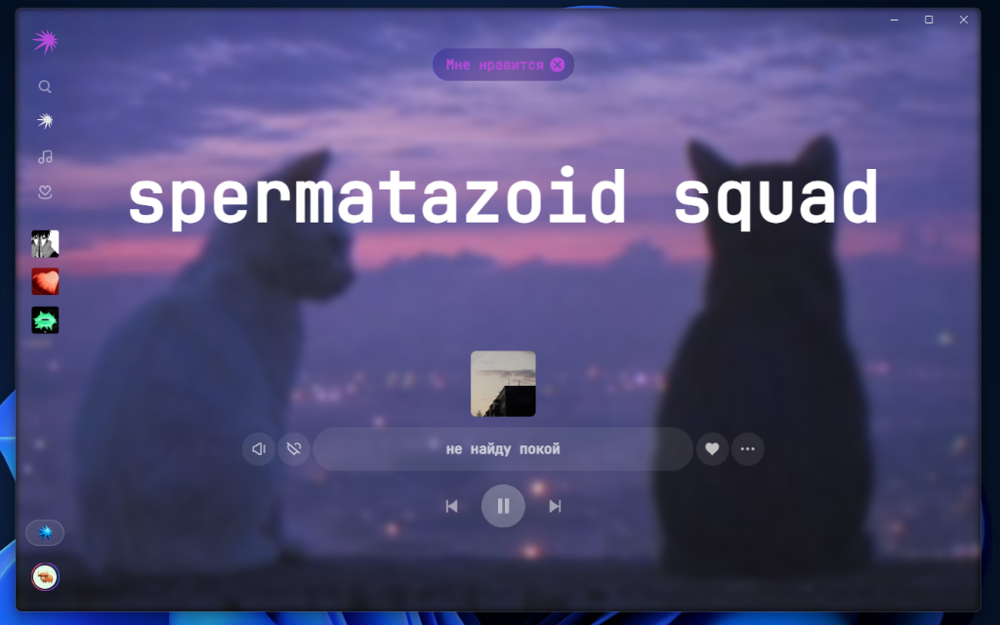
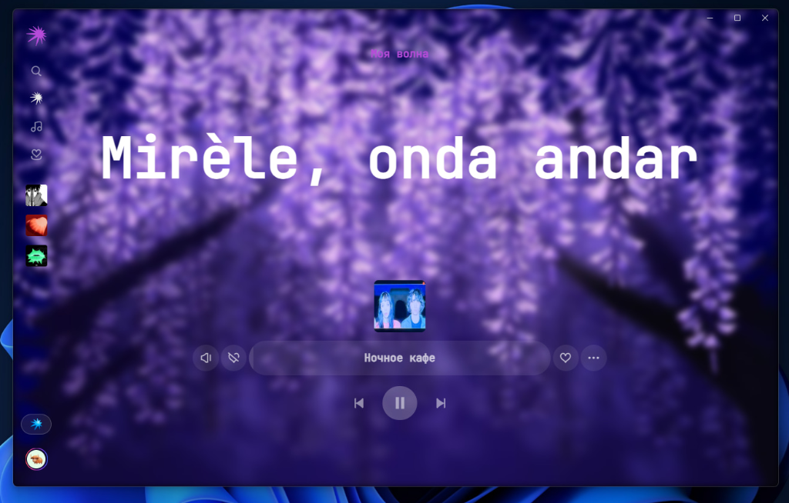

# 🎵 Luna Mod — Яндекс Музыка

<p align="center">
  
</p>

<p align="center">
  <a href="https://hits.sh/github.com/lobzik645/YandexMusicMod/"></a>
  
  
  
  
  <a href="https://t.me/artehall"></a>
  <a href="https://t.me/+IcRgeI5RJqs2NDdi"></a>
</p>

---

Современная модификация для десктопного клиента **Яндекс Музыки** с глубокой кастомизацией интерфейса, поддержкой **статичных фонов, анимированных GIF и видео**, встроенным загрузчиком треков, Discord RPC, **подробной статистикой прослушиваний** и снятием цензуры.

---

## 📸 Скриншоты и кастомизация фона

Вы можете полностью преобразить плеер под свой вкус — установить любую картинку, анимированную **GIF** или **видео** на фон, настроить прозрачность и размытие:

<p align="center">
  
  
</p>

---

## ✨ Основные возможности

### 🖼️ Свой фон (Картинки, GIF и Видео)
- **Любые изображения и GIF:** ставьте свои любимые арты, фотографии или анимированные гифки на весь экран.
- **Видео-фоны:** поддержка плавных зацикленных видео (.mp4, .webm).
- **Тонкая настройка:** регулировка размытия (blur), прозрачности, яркости и масштабирования фона.
- **Готовые пресеты:** встроенная подборка красивых фонов (Cyberpunk, Nebula, Lofi, Synthwave и др.).

### 🎨 Кастомизация интерфейса
- **Смена шрифтов:** выбирайте встроенные шрифты (Minecraft, JetBrains Mono, Andy Bold и др.) или используйте системные.
- **Масштаб UI:** удобное изменение масштаба интерфейса приложения под любой экран.
- **Кастомные темы:** выбор любых акцентных цветов, градиентов и неонового оформления.
- **Новогодний снегопад:** атмосферная анимация падающего снега.

### ⬇️ Скачивание музыки
- Скачивание текущего трека, целого альбома, плейлиста или всех треков артиста.
- Поддержка качества **Lossless (FLAC)** и 320 kbps MP3 с сохранением тегов и обложек.
- Удобный выбор и открытие папки для загрузок прямо из приложения.

### 🚫 Обход цензуры (YM Liberty)
- Автоматическая подмена зацензуренных или заглушенных версий треков на оригинальные студийные версии без купюр.
- Возможность вручную выбрать локальный аудиофайл для замены любого трека в медиатеке.

### 🎮 Discord Rich Presence
- Красивый статус в вашем Discord-профиле: название трека, исполнители, альбом, обложка и кликабельные кнопки для перехода.

### 📊 Аналитика и статистика прослушиваний
- **Учёт времени и треков:** наглядные карточки со временем прослушивания и количеством треков за **Сегодня**, **Неделю**, **Месяц** и за **Всё время**.
- **Топ любимых исполнителей:** динамический рейтинг любимых артистов с интерактивными прогресс-барами и подсчётом прослушиваний.
- **Честный подсчёт:** учитываются только полноценно прослушанные треки (быстро пропущенные треки не искажают статистику).
- **Управление историей:** возможность в любой момент просмотреть статистику или очистить её в один клик.

### ⚡ Прочие улучшения
- **Plus Unlocker:** доступ к функциям подписки и автоматический выбор наилучшего качества звука (FLAC / Lossless).
- **Авто-лайкер:** перенос треков и автоматическое добавление в «Мне нравится».
- **Встроенные DevTools:** консоль разработчика по нажатию `Ctrl+Shift+I` или `F12`.

---

## 📥 Установка

1. Перейдите в раздел **[Releases](../../releases)** и скачайте актуальный файл **`Яндекс Музыка Setup 5.121.2.exe`**.
2. Запустите установщик. Официальный клиент отдельно ставить не нужно — всё уже встроено в сборку.
3. Откройте приложение. Для доступа к меню настроек мода нажмите кнопку **Luna mod** в боковой панели или используйте сочетание клавиш **`Alt + M`**.

---

## 🎬 Как установить свой фон или GIF

1. Откройте меню мода (**`Alt + M`** или кнопка *Luna mod* слева).
2. Перейдите во вкладку **«Фон»**.
3. Включите тумблер **«Включить кастомный фон»**.
4. Нажмите **«Выбрать файл»** и укажите любое изображение, **.gif** анимацию или **.mp4** видео с вашего компьютера (или вставьте прямую ссылку на картинку/гифку).
5. Настройте ползунки **«Размытие»** и **«Прозрачность»** для идеальной читаемости интерфейса.

---

## 🛠 Сборка из исходников

Если вы хотите внести свои изменения и собрать проект самостоятельно:

### Требования
- [Bun](https://bun.sh/) (v1.2+)
- [Node.js](https://nodejs.org/) (v18+)

### Инструкция по сборке

1. Склонируйте репозиторий:
   ```bash
   git clone https://github.com/lobzik645/YandexMusicMod.git
   cd YandexMusicMod
   ```

2. Установите зависимости:
   ```bash
   bun install
   ```

3. Соберите интерфейс мода:
   ```bash
   bun run ui:build
   ```

4. Соберите готовый установочный `.exe`:
   ```bash
   bun run start
   ```
   Готовый инсталлятор появится в корне проекта и в папке `dist`.

---

## 💖 Поддержка разработчика / Донат

Мод полностью бесплатен и разрабатывается для пользователей. Если проект вам помог и вы хотите поддержать дальнейшую разработку:

* 💳 **Банковская карта (RU):** `2200 7021 6738 7641`
* 💎 **TON / Gram (DeFi):** `UQCn9ZKq8URRXFgv0zEQa9AbIQNqS6tN3xRI6p5u0vE2a9TL`

---

## 👤 Автор и сообщество

* ✈️ **Telegram автора:** [@artehall](https://t.me/artehall)
* 📢 **Личный Telegram канал:** [t.me/+IcRgeI5RJqs2NDdi](https://t.me/+IcRgeI5RJqs2NDdi)
* 💻 **GitHub автора:** [@lobzik645](https://github.com/lobzik645)

---

## 💖 Благодарности

- [**Stephanzion**](https://github.com/Stephanzion/YandexMusicBetaMod) — оригинальный патчер и React-моды.
- [**HoleverGG**](https://github.com/HoleverGG/YandexMusicBetaMod) — адаптация мода под актуальные версии клиента.
- [**Hazzz895**](https://github.com/Hazzz895/FckCensor) — база треков и система обхода цензуры.

---

## 📄 Лицензия

Проект распространяется под лицензией [MIT](./LICENSE).
